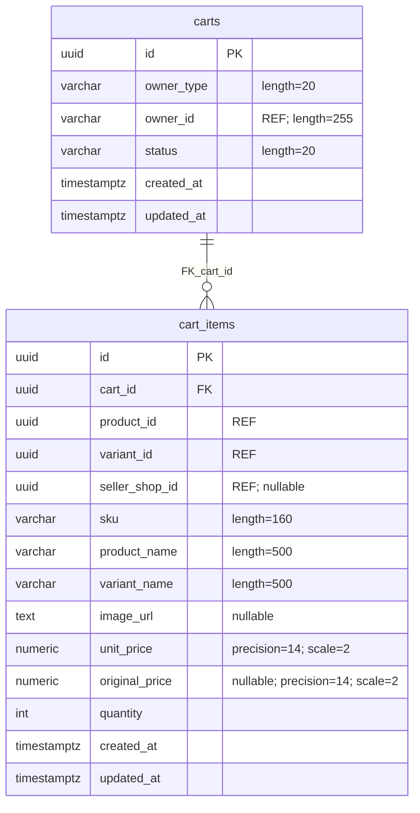
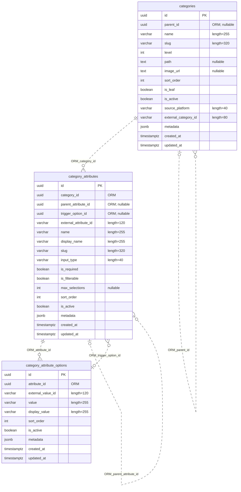
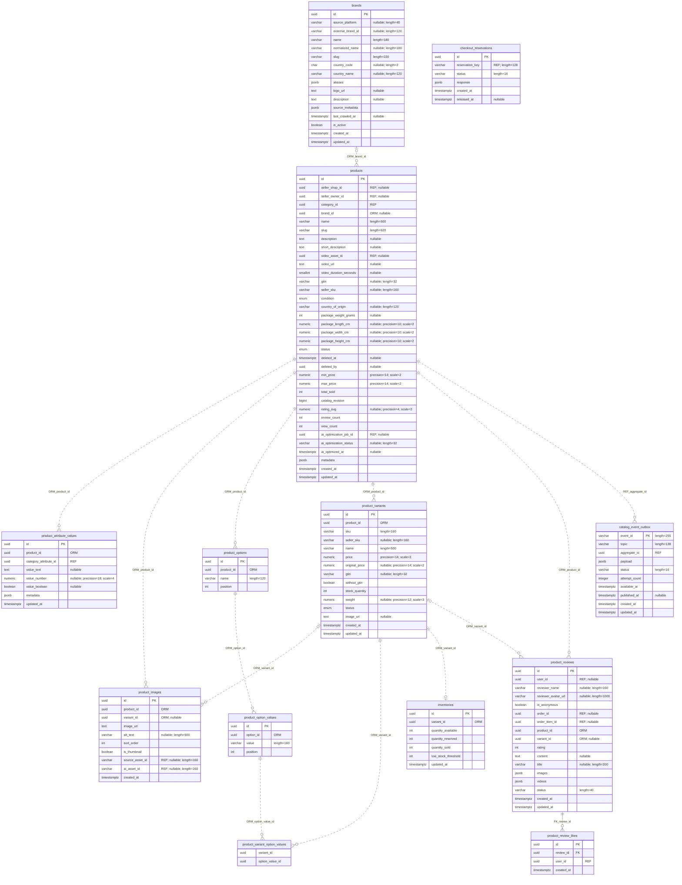
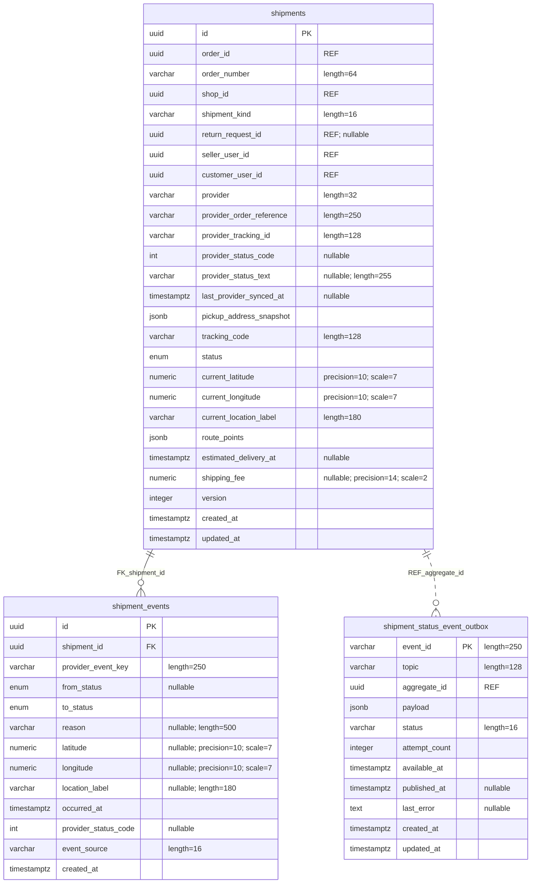
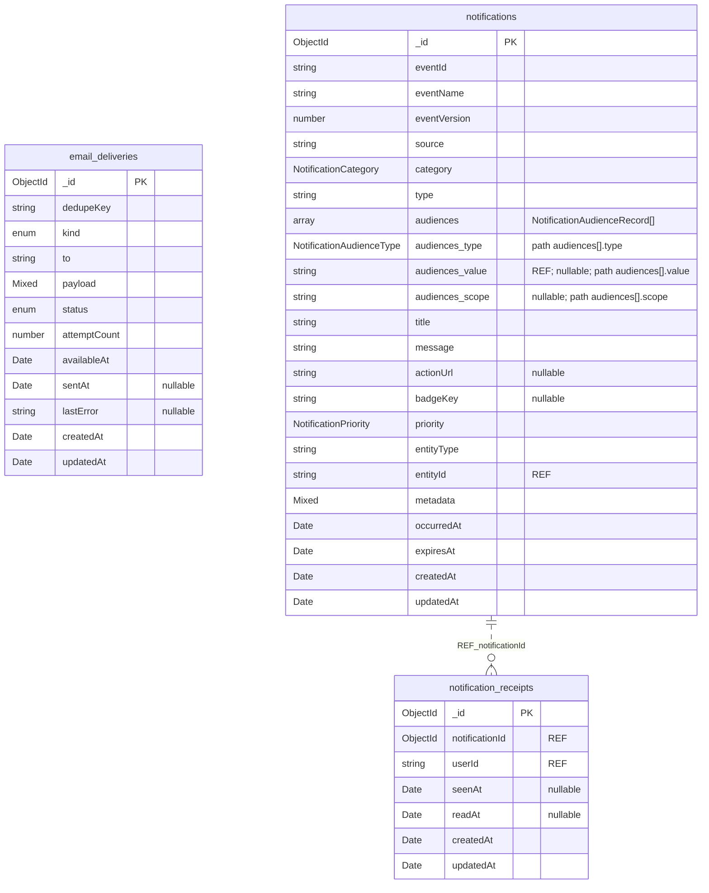
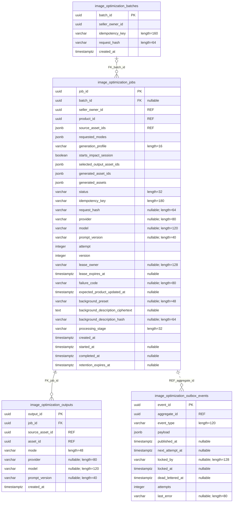

# Database theo service

Sơ đồ được tách riêng theo service để bảng và field không bị ép nhỏ. Mỗi ERD liệt kê đầy đủ field và kiểu; đường FK vật lý, relation ORM và REF logic được ghi nhãn riêng.

## Tổng quan

| Service                | Lưu trữ    | Bảng/collection |    Field |
| ---------------------- | ---------- | --------------: | -------: |
| Auth Service           | PostgreSQL |              12 |      137 |
| Cart Service           | PostgreSQL |               2 |       20 |
| Catalog Service        | PostgreSQL |               3 |       42 |
| Product Service        | PostgreSQL |              13 |      139 |
| Seller Service         | PostgreSQL |              16 |      206 |
| Order Service          | PostgreSQL |              14 |      239 |
| Shipping Service       | PostgreSQL |               3 |       50 |
| Notification Service   | MongoDB    |               3 |       42 |
| Recommendation Service | PostgreSQL |              16 |      163 |
| AI Service             | PostgreSQL |               4 |       56 |
| API Gateway            | Redis      |               — |        — |
| Media Service          | S3         |               — |        — |
| **Tổng**               |            |          **86** | **1094** |

Trong ERD: PK/FK là khóa trong schema; ORM là relation khai báo nhưng không có FK vật lý; REF là ID logic không được database kiểm tra. Kiểu có độ dài/precision hiển thị trong ghi chú field, NULL đánh dấu field nullable. Audience fields là subdocument bên trong notifications. Ngay sau mỗi ERD có một bảng mô tả, mỗi bảng/collection xuất hiện đúng một dòng.

### Rà soát các bảng không có cạnh nội service

- Độc lập có chủ ý: `auth.otp_challenges` (OTP nhận diện bằng email/điện thoại, kể cả trước khi tạo tài khoản), `notification.email_deliveries` (hàng đợi email nhận event snapshot) và `recommendation.recommendation_catalog_sync_checkpoints` (con trỏ trang đồng bộ).
- Chỉ có tham chiếu ngoài service: `product.checkout_reservations` dùng chung `order.orders.idempotency_key`; `recommendation.recommendation_policies.created_by` tham chiếu `auth.users`. Hai quan hệ này được liệt kê trong phần tham chiếu của service tương ứng và không tạo FK.

## Auth Service · PostgreSQL

```mermaid
erDiagram
  access_navigation_items {
    uuid id PK
    uuid parent_id "REF; nullable"
    varchar area "length=40"
    varchar group_code "length=80"
    varchar group_label "length=120"
    int group_order
    varchar code "length=120"
    varchar label "length=120"
    varchar description "length=180"
    varchar href "length=240"
    varchar icon "length=80"
    int sort_order
    varchar required_permission_code "length=160"
    varchar required_scope "nullable; length=40"
    boolean is_active
    timestamptz created_at
    timestamptz updated_at
  }
  access_permission_audit_logs {
    uuid id PK
    uuid actor_user_id "REF; nullable"
    uuid target_user_id "REF; nullable"
    uuid role_id "REF; nullable"
    uuid permission_id "REF; nullable"
    varchar action "length=80"
    jsonb before "nullable"
    jsonb after "nullable"
    text reason "nullable"
    varchar ip_address "nullable; length=45"
    text user_agent "nullable"
    timestamptz created_at
  }
  access_permissions {
    uuid id PK
    varchar code "length=160"
    varchar name "length=160"
    text description "nullable"
    varchar resource "length=100"
    varchar action "length=80"
    varchar permission_version "length=40"
    boolean is_active
    timestamptz created_at
    timestamptz updated_at
  }
  access_role_permissions {
    uuid id PK
    uuid role_id "ORM"
    uuid permission_id "ORM"
    varchar scope "length=40"
    boolean is_active
    timestamptz created_at
    timestamptz updated_at
  }
  access_roles {
    uuid id PK
    varchar code "length=80"
    varchar name "length=120"
    text description "nullable"
    boolean is_system
    boolean is_active
    timestamptz created_at
    timestamptz updated_at
  }
  access_user_roles {
    uuid id PK
    uuid user_id "ORM"
    uuid role_id "ORM"
    uuid assigned_by "nullable"
    timestamptz expires_at "nullable"
    boolean is_active
    timestamptz created_at
    timestamptz updated_at
  }
  otp_challenges {
    uuid id PK
    varchar identifier "length=255"
    varchar otp_hash "length=64"
    varchar purpose "length=30"
    timestamptz expires_at
    int attempts
    int max_attempts
    timestamptz resend_at "nullable"
    text extra_data "nullable"
    timestamptz created_at
  }
  refresh_tokens {
    uuid id PK
    uuid user_id "ORM"
    varchar token_hash "length=64"
    varchar device_name "nullable; length=150"
    varchar device_type "nullable; length=30"
    varchar browser "nullable; length=80"
    varchar os "nullable; length=80"
    varchar location "nullable; length=150"
    varchar login_method "nullable; length=40"
    timestamptz issued_at
    timestamptz last_active_at "nullable"
    timestamptz expires_at
    timestamptz revoked_at "nullable"
    varchar revoked_reason "nullable; length=60"
    varchar ip_address "nullable; length=45"
    text user_agent "nullable"
    varchar client_id "nullable; length=100"
  }
  user_addresses {
    uuid id PK
    uuid user_id "ORM"
    varchar label "length=50"
    varchar full_name "length=100"
    varchar phone "length=20"
    varchar province "length=100"
    int ghn_province_id "nullable"
    varchar ghn_province_name "nullable; length=100"
    varchar district "length=100"
    int ghn_district_id "nullable"
    varchar ghn_district_name "nullable; length=100"
    varchar ward "length=100"
    varchar ghn_ward_code "nullable; length=30"
    varchar ghn_ward_name "nullable; length=100"
    text street
    boolean is_default
    timestamptz created_at
  }
  user_admin_audit_logs {
    uuid id PK
    uuid actor_user_id "REF; nullable"
    uuid target_user_id "REF"
    varchar action "length=80"
    jsonb before "nullable"
    jsonb after "nullable"
    text reason "nullable"
    varchar sync_status "length=20"
    varchar ip_address "nullable; length=45"
    text user_agent "nullable"
    timestamptz created_at
  }
  user_refund_bank_accounts {
    uuid id PK
    uuid user_id FK
    varchar bank_code "length=50"
    varchar bank_name "length=100"
    varchar account_holder "length=100"
    varchar account_number "length=30"
    boolean is_default
    timestamptz created_at
    timestamptz updated_at
  }
  users {
    uuid id PK
    varchar email "length=255"
    varchar name "length=100"
    varchar phone "nullable; length=20"
    varchar keycloak_id "length=36"
    varchar role "length=50"
    varchar status "length=20"
    text avatar_url "nullable"
    timestamptz last_login_at "nullable"
    timestamptz created_at
    timestamptz updated_at
  }
  users ||--o{ user_refund_bank_accounts : FK_user_id
  users ||..o{ refresh_tokens : ORM_user_id
  access_roles ||..o{ access_role_permissions : ORM_role_id
  access_permissions ||..o{ access_role_permissions : ORM_permission_id
  users ||..o{ user_addresses : ORM_user_id
  users ||..o{ access_user_roles : ORM_user_id
  access_roles ||..o{ access_user_roles : ORM_role_id
  users o|..o{ access_permission_audit_logs : REF_actor_user_id
  users o|..o{ access_permission_audit_logs : REF_target_user_id
  access_roles o|..o{ access_permission_audit_logs : REF_role_id
  access_permissions o|..o{ access_permission_audit_logs : REF_permission_id
  users o|..o{ user_admin_audit_logs : REF_actor_user_id
  users ||..o{ user_admin_audit_logs : REF_target_user_id
  access_navigation_items o|..o{ access_navigation_items : REF_parent_id
```

### Mô tả chức năng từng bảng

| Bảng/collection                | Mô tả ngắn: bảng dùng để làm gì                                                                                             |
| ------------------------------ | --------------------------------------------------------------------------------------------------------------------------- |
| `access_navigation_items`      | Cấu hình menu admin/seller, thứ tự hiển thị và mã quyền yêu cầu. parent_id mô tả cây menu nhưng không có FK entity.         |
| `access_permission_audit_logs` | Lưu thay đổi quyền/vai trò và các ID đối tượng liên quan để truy vết.                                                       |
| `access_permissions`           | Danh mục quyền theo resource/action và version.                                                                             |
| `access_role_permissions`      | Gán quyền cho vai trò theo phạm vi áp dụng.                                                                                 |
| `access_roles`                 | Danh mục vai trò người dùng và trạng thái hoạt động.                                                                        |
| `access_user_roles`            | Gán vai trò cho user, có người gán, scope thời gian và trạng thái.                                                          |
| `otp_challenges`               | Challenge OTP theo email hoặc số điện thoại, mục đích và thời hạn; đứng độc lập vì có thể xác minh trước khi tạo tài khoản. |
| `refresh_tokens`               | Phiên đăng nhập đã băm token, thông tin client và thời hạn thu hồi.                                                         |
| `user_addresses`               | Sổ địa chỉ giao hàng; giữ cả mã địa giới GHN.                                                                               |
| `user_admin_audit_logs`        | Lưu hành động quản trị lên tài khoản cùng dữ liệu trước/sau và lý do.                                                       |
| `user_refund_bank_accounts`    | Tài khoản ngân hàng người dùng chọn để nhận hoàn tiền.                                                                      |
| `users`                        | Hồ sơ tài khoản, trạng thái đăng nhập và liên kết tới Keycloak.                                                             |

## Cart Service · PostgreSQL

### Mô tả chức năng từng bảng

| Bảng/collection | Mô tả ngắn: bảng dùng để làm gì                                                                                                |
| --------------- | ------------------------------------------------------------------------------------------------------------------------------ |
| `cart_items`    | Dòng hàng và snapshot tên, SKU, ảnh, giá, số lượng tại thời điểm thêm. Product, variant và shop là ID tham chiếu service khác. |
| `carts`         | Giỏ của user hoặc guest, gồm trạng thái giỏ hiện tại.                                                                          |

### Tham chiếu sang service khác

| Bảng/cột trong service           | Tham chiếu đến             | Ghi chú                   |
| -------------------------------- | -------------------------- | ------------------------- |
| `cart.carts.owner_id`            | `auth.users`               | chỉ khi owner_type = USER |
| `cart.cart_items.seller_shop_id` | `seller.shops`             | shop của dòng giỏ         |
| `cart.cart_items.product_id`     | `product.products`         | sản phẩm trong dòng giỏ   |
| `cart.cart_items.variant_id`     | `product.product_variants` | biến thể trong dòng giỏ   |

## Catalog Service · PostgreSQL

### Mô tả chức năng từng bảng

| Bảng/collection              | Mô tả ngắn: bảng dùng để làm gì                                                                                                                    |
| ---------------------------- | -------------------------------------------------------------------------------------------------------------------------------------------------- |
| `categories`                 | Cây danh mục, đường dẫn, trạng thái lá và metadata từ nguồn catalog.                                                                               |
| `category_attribute_options` | Các giá trị lựa chọn cho thuộc tính dạng select.                                                                                                   |
| `category_attributes`        | Định nghĩa form thuộc tính theo danh mục, có thể lồng cha/con và điều kiện hiển thị dựa trên option; các liên kết được thể hiện riêng trong sơ đồ. |

## Product Service · PostgreSQL

### Mô tả chức năng từng bảng

| Bảng/collection                 | Mô tả ngắn: bảng dùng để làm gì                                                                                      |
| ------------------------------- | -------------------------------------------------------------------------------------------------------------------- |
| `brands`                        | Thương hiệu, tên chuẩn hóa/alias và metadata đồng bộ nguồn ngoài.                                                    |
| `catalog_event_outbox`          | Giữ event catalog trong cùng transaction để đồng bộ sang Recommendation có thể retry.                                |
| `checkout_reservations`         | Ledger idempotency để giữ/nhả tồn kho; reservation_key dùng cùng idempotency_key từ Order, không có FK giữa service. |
| `inventories`                   | Counter tồn kho theo variant: bán được, đã giữ, đã bán và ngưỡng cảnh báo.                                           |
| `product_attribute_values`      | Giá trị thuộc tính theo category; category_attribute_id thuộc Catalog Service nên không có FK liên service.          |
| `product_images`                | Ảnh sản phẩm/variant, thứ tự hiển thị và ID asset gốc/AI.                                                            |
| `product_option_values`         | Giá trị cụ thể trong từng nhóm lựa chọn.                                                                             |
| `product_options`               | Nhóm lựa chọn như màu sắc hoặc kích cỡ.                                                                              |
| `product_review_likes`          | Lượt thích review; unique theo review và user để chống ghi trùng.                                                    |
| `product_reviews`               | Đánh giá, bằng chứng mua và snapshot người đánh giá; order/user ID không có FK sang service sở hữu.                  |
| `product_variant_option_values` | Bảng nối variant với các giá trị lựa chọn, dùng khóa chính kép.                                                      |
| `product_variants`              | SKU, giá, mã GTIN và lựa chọn bán được của sản phẩm.                                                                 |
| `products`                      | Thông tin sản phẩm, seller/category ID, trạng thái, thống kê và revision catalog.                                    |

### Tham chiếu sang service khác

| Bảng/cột trong service                                   | Tham chiếu đến                 | Ghi chú                                                       |
| -------------------------------------------------------- | ------------------------------ | ------------------------------------------------------------- |
| `product.products.seller_owner_id`                       | `auth.users`                   | chủ sản phẩm                                                  |
| `product.products.seller_shop_id`                        | `seller.shops`                 | shop sở hữu sản phẩm                                          |
| `product.products.category_id`                           | `catalog.categories`           | danh mục sản phẩm                                             |
| `product.product_attribute_values.category_attribute_id` | `catalog.category_attributes`  | định nghĩa thuộc tính của Catalog                             |
| `product.product_reviews.user_id`                        | `auth.users`                   | người viết đánh giá                                           |
| `product.product_reviews.order_id`                       | `order.orders`                 | đơn dùng để xác minh giao dịch                                |
| `product.product_reviews.order_item_id`                  | `order.order_items`            | dòng hàng dùng để xác minh đánh giá                           |
| `product.product_review_likes.user_id`                   | `auth.users`                   | người thích đánh giá                                          |
| `product.products.ai_optimization_job_id`                | `ai.image_optimization_jobs`   | job AI được áp dụng lên sản phẩm                              |
| `product.product_images.source_asset_id`                 | `media.asset_store`            | asset ảnh gốc                                                 |
| `product.product_images.ai_asset_id`                     | `media.asset_store`            | asset ảnh AI đã áp dụng                                       |
| `product.products.video_asset_id`                        | `media.asset_store`            | asset video sản phẩm                                          |
| `product.checkout_reservations.reservation_key`          | `order.orders.idempotency_key` | cùng khóa dùng khi Order reserve/release tồn kho; không có FK |

## Seller Service · PostgreSQL

```mermaid
erDiagram
  seller_applications {
    uuid id PK
    uuid user_id "REF"
    varchar user_email "length=255"
    enum status
    varchar shop_name "nullable; length=120"
    varchar shop_slug "nullable; length=140"
    uuid main_category_id "REF; nullable"
    varchar business_model "nullable; length=40"
    text shop_description "nullable"
    text logo_url "nullable"
    enum profile_type
    varchar legal_name "nullable; length=180"
    varchar citizen_id "nullable; length=20"
    varchar tax_code "nullable; length=30"
    varchar representative_name "nullable; length=160"
    varchar representative_role "nullable; length=120"
    varchar contact_phone "nullable; length=20"
    varchar contact_email "nullable; length=255"
    jsonb verification_documents
    varchar pickup_contact_name "nullable; length=160"
    varchar pickup_phone "nullable; length=20"
    int pickup_ghn_province_id "nullable"
    varchar pickup_ghn_province_name "nullable; length=160"
    int pickup_ghn_district_id "nullable"
    varchar pickup_ghn_district_name "nullable; length=160"
    varchar pickup_ghn_ward_code "nullable; length=30"
    varchar pickup_ghn_ward_name "nullable; length=160"
    text pickup_address_line "nullable"
    varchar bank_code "nullable; length=60"
    varchar bank_name "nullable; length=120"
    varchar bank_account_number "nullable; length=40"
    varchar bank_account_holder_name "nullable; length=180"
    enum bank_account_type
    varchar bank_branch "nullable; length=160"
    timestamptz submitted_at "nullable"
    timestamptz reviewed_at "nullable"
    text review_note "nullable"
    jsonb correction_targets
    jsonb correction_snapshot_hashes
    int submission_revision
    jsonb metadata
    timestamptz created_at
    timestamptz updated_at
  }
  seller_copilot_action_proposals {
    uuid id PK
    uuid conversation_id FK
    uuid owner_user_id "REF"
    uuid shop_id "REF"
    uuid batch_id "nullable"
    varchar status "length=40"
    jsonb payload
    timestamptz expires_at
    jsonb result "nullable"
    timestamptz completed_at "nullable"
    timestamptz created_at
  }
  seller_copilot_conversations {
    uuid id PK
    uuid owner_user_id "REF"
    uuid shop_id "REF"
    varchar title "length=32"
    boolean is_pinned
    timestamptz pinned_at "nullable"
    timestamptz created_at
    timestamptz updated_at
  }
  seller_copilot_feedback {
    uuid id PK
    uuid message_id "REF"
    uuid owner_user_id "REF"
    uuid shop_id "REF"
    varchar rating "length=8"
    varchar reason "nullable; length=300"
    timestamptz created_at
  }
  seller_copilot_messages {
    uuid id PK
    uuid conversation_id FK
    varchar role "length=20"
    text content
    jsonb metadata "nullable"
    timestamptz created_at
  }
  seller_knowledge_audit_events {
    uuid id PK
    uuid actor_id
    varchar action "length=40"
    varchar entity_type "length=40"
    varchar entity_id "length=100"
    uuid revision_id FK "nullable"
    jsonb details
    timestamptz created_at
  }
  seller_knowledge_documents {
    uuid id PK
    varchar slug "length=160"
    varchar title "length=200"
    varchar domain_code FK "length=80"
    varchar language "length=10"
    varchar status "length=20"
    date effective_from "nullable"
    date effective_to "nullable"
    uuid published_revision_id FK "nullable"
    uuid created_by
    uuid updated_by
    timestamptz created_at
    timestamptz updated_at
  }
  seller_knowledge_domains {
    varchar code PK "length=80"
    varchar label "length=120"
    text description
    jsonb examples
    varchar kind "length=20"
    varchar implementation_key "nullable; length=100"
    varchar status "length=20"
    uuid created_by
    uuid updated_by
    timestamptz created_at
    timestamptz updated_at
  }
  seller_knowledge_publish_jobs {
    uuid id PK
    uuid revision_id FK
    varchar status "length=20"
    integer attempts
    text last_error "nullable"
    uuid requested_by
    timestamptz lease_until "nullable"
    timestamptz created_at
    timestamptz updated_at
  }
  seller_knowledge_revisions {
    uuid id PK
    uuid document_id FK
    integer revision_number
    varchar source_object_key "length=500"
    varchar content_hash "length=64"
    integer content_size
    jsonb document_metadata
    varchar status "length=20"
    jsonb validation_report "nullable"
    uuid created_by
    timestamptz created_at
  }
  shop_compliance_profiles {
    uuid id PK
    uuid shop_id "ORM"
    enum profile_type
    varchar legal_name "length=180"
    varchar citizen_id "nullable; length=20"
    varchar tax_code "nullable; length=30"
    varchar representative_name "length=160"
    varchar representative_role "nullable; length=120"
    varchar legal_contact_email "length=255"
    varchar legal_contact_phone "length=20"
    jsonb verification_documents
    varchar bank_code "length=60"
    varchar bank_name "length=120"
    varchar bank_account_number "length=40"
    varchar bank_account_holder_name "length=180"
    enum bank_account_type
    varchar bank_branch "nullable; length=160"
    integer version
    timestamptz verified_at
    timestamptz created_at
    timestamptz updated_at
  }
  shop_follows {
    uuid id PK
    uuid shop_id FK
    uuid follower_user_id "REF"
    timestamptz created_at
  }
  shop_pickup_addresses {
    uuid id PK
    uuid shop_id
    varchar contact_name "length=160"
    varchar phone "length=20"
    int ghn_province_id "nullable"
    varchar ghn_province_name "nullable; length=160"
    int ghn_district_id "nullable"
    varchar ghn_district_name "nullable; length=160"
    varchar ghn_ward_code "nullable; length=30"
    varchar ghn_ward_name "nullable; length=160"
    text address_line
    boolean is_default
    timestamptz created_at
    timestamptz updated_at
  }
  shop_profile_change_requests {
    uuid id PK
    uuid shop_id "ORM"
    uuid requester_user_id "REF"
    enum sections
    jsonb current_snapshot
    jsonb requested_changes
    integer base_compliance_version
    varchar request_note "length=500"
    enum status
    uuid reviewed_by "nullable"
    varchar review_note "nullable; length=1000"
    timestamptz submitted_at
    timestamptz reviewed_at "nullable"
    timestamptz created_at
    timestamptz updated_at
  }
  shop_shipping_settings {
    uuid shop_id PK
    uuid default_pickup_address_id "REF; nullable"
    boolean onboarding_address_synced
    smallint preparation_time_hours
    time pickup_window_start
    time pickup_window_end
    boolean enabled
    timestamptz updated_at
  }
  shops {
    uuid id PK
    uuid owner_user_id "REF"
    uuid seller_application_id "ORM"
    varchar name "length=120"
    varchar slug "length=140"
    text logo_url
    text description "nullable"
    uuid main_category_id "REF"
    varchar business_model "length=40"
    varchar contact_email "length=255"
    varchar contact_phone "length=20"
    enum status
    int follower_count
    int following_count
    timestamptz verified_at
    timestamptz created_at
    timestamptz updated_at
  }
  shops ||--o{ shop_follows : FK_shop_id
  seller_copilot_conversations ||--o{ seller_copilot_messages : FK_conversation_id
  seller_copilot_conversations ||--o{ seller_copilot_action_proposals : FK_conversation_id
  seller_knowledge_domains ||--o{ seller_knowledge_documents : FK_domain_code
  seller_knowledge_documents ||--o{ seller_knowledge_revisions : FK_document_id
  seller_knowledge_revisions o|--o{ seller_knowledge_documents : FK_published_revision_id
  seller_knowledge_revisions ||--o{ seller_knowledge_publish_jobs : FK_revision_id
  seller_knowledge_revisions o|--o{ seller_knowledge_audit_events : FK_revision_id
  shops ||..o| shop_compliance_profiles : ORM_shop_id
  shops ||..o{ shop_profile_change_requests : ORM_shop_id
  seller_applications ||..o| shops : ORM_seller_application_id
  shops ||..o{ seller_copilot_conversations : REF_shop_id
  shops ||..o{ seller_copilot_feedback : REF_shop_id
  seller_copilot_messages ||..o{ seller_copilot_feedback : REF_message_id
  shops ||..o{ seller_copilot_action_proposals : REF_shop_id
  shop_pickup_addresses o|..o{ shop_shipping_settings : REF_default_pickup_address_id
```

### Mô tả chức năng từng bảng

| Bảng/collection                   | Mô tả ngắn: bảng dùng để làm gì                                                                                                                   |
| --------------------------------- | ------------------------------------------------------------------------------------------------------------------------------------------------- |
| `seller_applications`             | Hồ sơ đăng ký bán hàng, giấy tờ, địa chỉ nhận hàng và trạng thái xét duyệt.                                                                       |
| `seller_copilot_action_proposals` | Các hành động copilot đã chuẩn bị nhưng cần seller xác nhận; payload và hạn dùng giúp chỉ áp dụng đề xuất còn hiệu lực.                           |
| `seller_copilot_conversations`    | Cuộc hội thoại gắn với owner/shop và trạng thái ghim.                                                                                             |
| `seller_copilot_feedback`         | Đánh giá hữu ích theo message, owner và shop; message_id không có FK migration.                                                                   |
| `seller_copilot_messages`         | Nội dung từng message cùng metadata citation/trạng thái trả lời.                                                                                  |
| `seller_knowledge_audit_events`   | Audit actor, hành động và revision liên quan.                                                                                                     |
| `seller_knowledge_documents`      | Metadata tài liệu cùng domain và revision đang publish; nội dung Markdown nằm trong object storage, published_revision_id trỏ revision hiện hành. |
| `seller_knowledge_domains`        | Danh mục phạm vi tri thức như chính sách, profile hoặc live data.                                                                                 |
| `seller_knowledge_publish_jobs`   | Retry/lease cho công việc publish và lập chỉ mục revision.                                                                                        |
| `seller_knowledge_revisions`      | Phiên bản bất biến của tài liệu với source key, hash và kết quả kiểm tra; publish/audit bám theo revision để replay an toàn.                      |
| `shop_compliance_profiles`        | Hồ sơ pháp lý, đại diện và tài khoản nhận tiền của shop.                                                                                          |
| `shop_follows`                    | Quan hệ theo dõi shop; có FK tới shop, follower user là ID tham chiếu.                                                                            |
| `shop_pickup_addresses`           | Danh sách địa chỉ lấy hàng đã gắn mã địa giới GHN.                                                                                                |
| `shop_profile_change_requests`    | Snapshot thay đổi hồ sơ shop để admin review trước khi áp dụng.                                                                                   |
| `shop_shipping_settings`          | Thời gian chuẩn bị, khung giờ lấy hàng và địa chỉ lấy mặc định.                                                                                   |
| `shops`                           | Hồ sơ shop đã được tạo, owner, slug, category và trạng thái hoạt động.                                                                            |

### Tham chiếu sang service khác

| Bảng/cột trong service                                  | Tham chiếu đến       | Ghi chú                   |
| ------------------------------------------------------- | -------------------- | ------------------------- |
| `seller.seller_applications.user_id`                    | `auth.users`         | người nộp hồ sơ           |
| `seller.seller_applications.main_category_id`           | `catalog.categories` | ngành hàng đăng ký        |
| `seller.shops.owner_user_id`                            | `auth.users`         | chủ shop                  |
| `seller.shops.main_category_id`                         | `catalog.categories` | ngành hàng chính của shop |
| `seller.shop_follows.follower_user_id`                  | `auth.users`         | người theo dõi shop       |
| `seller.shop_profile_change_requests.requester_user_id` | `auth.users`         | người yêu cầu thay đổi    |
| `seller.seller_copilot_conversations.owner_user_id`     | `auth.users`         | chủ hội thoại             |
| `seller.seller_copilot_feedback.owner_user_id`          | `auth.users`         | người gửi phản hồi        |
| `seller.seller_copilot_action_proposals.owner_user_id`  | `auth.users`         | người xác nhận đề xuất    |

## Order Service · PostgreSQL

```mermaid
erDiagram
  finance_settlement_batches {
    uuid id PK
    varchar status "length=32"
    varchar note "nullable; length=500"
    varchar created_by "length=255"
    varchar reconciled_by "nullable; length=255"
    timestamptz reconciled_at "nullable"
    timestamptz created_at
  }
  order_delivery_issues {
    uuid id PK
    uuid order_id "REF"
    varchar owner_id "REF; length=255"
    enum reason
    jsonb item_ids "REF; order_items.id[]"
    jsonb evidence
    varchar note "nullable; length=1000"
    enum status
    uuid return_request_id "REF; nullable"
    timestamptz resolved_at "nullable"
    varchar resolved_by "nullable; length=255"
    varchar resolution_note "nullable; length=500"
    varchar refund_status "nullable; length=20"
    numeric refund_amount "nullable; precision=14; scale=2"
    varchar refund_method "nullable; length=40"
    varchar refund_transaction_reference "nullable; length=180"
    jsonb refund_proof "nullable"
    varchar refund_processed_by "nullable; length=255"
    timestamptz refund_processed_at "nullable"
    varchar refund_failure_note "nullable; length=500"
    varchar refund_failure_by "nullable; length=255"
    timestamptz created_at
    timestamptz updated_at
  }
  order_items {
    uuid id PK
    uuid order_id FK
    uuid product_id "REF"
    uuid variant_id "REF"
    uuid category_id "REF; nullable"
    uuid seller_shop_id "REF; nullable"
    uuid seller_owner_id "REF; nullable"
    varchar sku "length=160"
    varchar product_name "length=500"
    varchar variant_name "length=500"
    text image_url "nullable"
    numeric unit_price "precision=14; scale=2"
    int quantity
    numeric line_total "precision=14; scale=2"
    int package_weight_grams "nullable"
    numeric package_length_cm "nullable; precision=10; scale=2"
    numeric package_width_cm "nullable; precision=10; scale=2"
    numeric package_height_cm "nullable; precision=10; scale=2"
  }
  order_purchase_event_outbox {
    varchar event_id PK "length=255"
    varchar topic "length=128"
    uuid aggregate_id "REF; polymorphic"
    jsonb payload
    varchar status "length=16"
    integer attempt_count
    timestamptz available_at
    timestamptz published_at "nullable"
    timestamptz created_at
    timestamptz updated_at
  }
  order_return_requests {
    uuid id PK
    uuid order_id "REF"
    varchar owner_id "REF; length=255"
    uuid shop_id "REF"
    jsonb item_ids "REF; order_items.id[]"
    enum status
    varchar reason "length=120"
    varchar description "nullable; length=1000"
    varchar review_note "nullable; length=500"
    varchar shipment_failure_note "nullable; length=500"
    jsonb evidence
    numeric refund_amount "precision=14; scale=2"
    numeric estimated_refund_amount "precision=14; scale=2"
    numeric refund_item_amount "precision=14; scale=2"
    numeric refund_shipping_amount "precision=14; scale=2"
    numeric return_shipping_fee "precision=14; scale=2"
    numeric return_shipping_estimated_cost "precision=14; scale=2"
    numeric return_shipping_cost "precision=14; scale=2"
    varchar return_shipping_payer "nullable; length=16"
    timestamptz return_shipping_finalized_at "nullable"
    numeric customer_return_shipping_receivable_amount "precision=14; scale=2"
    uuid seller_user_id "REF; nullable"
    boolean inspection_passed "nullable"
    varchar inspection_note "nullable; length=1000"
    timestamptz inspected_at "nullable"
    varchar refund_method "nullable; length=40"
    varchar refund_request_id "nullable; length=32"
    varchar refund_transaction_reference "nullable; length=180"
    jsonb refund_proof "nullable"
    varchar refund_processed_by "nullable; length=255"
    timestamptz refund_processed_at "nullable"
    varchar refund_failure_note "nullable; length=500"
    varchar refund_failure_by "nullable; length=255"
    timestamptz requested_at
    timestamptz reviewed_at "nullable"
    timestamptz created_at
    timestamptz updated_at
  }
  order_status_history {
    uuid id PK
    uuid order_id FK
    enum from_status "nullable"
    enum to_status
    varchar reason "length=500"
    timestamptz created_at
  }
  orders {
    uuid id PK
    varchar order_number "length=32"
    varchar owner_id "REF; length=255"
    enum status
    enum fulfillment_status
    enum delivery_confirmation_status
    enum delivery_confirmation_method "nullable"
    timestamptz delivered_at "nullable"
    timestamptz delivery_confirmation_deadline "nullable"
    timestamptz delivery_confirmed_at "nullable"
    enum payment_status
    enum payment_method
    timestamptz payment_expires_at "nullable"
    boolean is_sandbox
    timestamptz cod_remitted_at "nullable"
    varchar cod_remittance_reference "nullable; length=120"
    varchar cod_remittance_confirmed_by "nullable; length=255"
    uuid checkout_cart_item_id "REF; nullable"
    uuid shipping_address_id "REF"
    jsonb shipping_address
    numeric subtotal "precision=14; scale=2"
    numeric shipping_fee "precision=14; scale=2"
    jsonb shipping_fee_breakdown
    timestamptz completed_at "nullable"
    timestamptz return_window_until "nullable"
    numeric total_amount "precision=14; scale=2"
    varchar note "nullable; length=500"
    varchar cancel_reason "nullable; length=500"
    timestamptz cancelled_at "nullable"
    varchar idempotency_key "length=128"
    varchar request_fingerprint "length=700"
    timestamptz created_at
    timestamptz updated_at
  }
  payment_attempts {
    uuid id PK
    uuid order_id FK
    varchar merchant_reference "length=64"
    varchar provider_request_id "nullable; length=80"
    varchar provider_order_info "nullable; length=180"
    varchar provider_transaction_id "nullable; length=64"
    varchar refund_request_id "nullable; length=32"
    varchar status "length=20"
    varchar environment "length=20"
    numeric amount "precision=14; scale=2"
    char currency "length=3"
    timestamptz expires_at
    char provider_create_date "nullable; length=14"
    timestamptz confirmed_at "nullable"
    varchar refund_transaction_reference "nullable; length=180"
    varchar refund_out_transaction_id "nullable; length=120"
    varchar refund_out_transaction_number "nullable; length=120"
    numeric refund_out_amount "nullable; precision=14; scale=2"
    timestamptz refund_out_detected_at "nullable"
    jsonb refund_proof "nullable"
    varchar refund_processed_by "nullable; length=255"
    timestamptz refund_processed_at "nullable"
    varchar refund_failure_note "nullable; length=500"
    varchar refund_failure_by "nullable; length=255"
    varchar refund_bank_code "nullable; length=50"
    varchar refund_bank_name "nullable; length=100"
    varchar refund_account_holder "nullable; length=100"
    varchar refund_account_number "nullable; length=30"
    uuid refund_bank_account_id "REF; nullable"
    jsonb provider_response "nullable"
    timestamptz created_at
  }
  platform_finance_ledger {
    uuid id PK
    varchar kind "length=40"
    numeric amount "precision=14; scale=2"
    varchar source_key "length=180"
    uuid shop_id "REF; nullable"
    uuid order_id "REF; nullable"
    uuid return_request_id "REF; nullable"
    varchar reference "nullable; length=120"
    uuid settlement_batch_id FK "nullable"
    varchar created_by "nullable; length=255"
    timestamptz created_at
  }
  seller_wallet_ledger {
    uuid id PK
    uuid shop_id "REF"
    uuid order_id "REF; nullable"
    uuid return_request_id "REF; nullable"
    varchar kind "length=32"
    numeric amount "precision=14; scale=2"
    varchar source_key "length=160"
    timestamptz available_at "nullable"
    timestamptz created_at
  }
  seller_wallets {
    uuid id PK
    uuid shop_id "REF"
    numeric pending_balance "precision=14; scale=2"
    numeric available_balance "precision=14; scale=2"
    numeric reserved_balance "precision=14; scale=2"
    timestamptz created_at
    timestamptz updated_at
  }
  wallet_deposits {
    uuid id PK
    uuid shop_id "REF"
    varchar seller_user_id "REF; length=255"
    varchar merchant_reference "length=64"
    varchar provider_transaction_id "nullable; length=64"
    varchar provider_request_id "nullable; length=80"
    varchar provider_order_info "nullable; length=180"
    varchar status "length=20"
    varchar environment "length=20"
    numeric amount "precision=14; scale=2"
    timestamptz expires_at
    jsonb provider_response "nullable"
    timestamptz confirmed_at "nullable"
    timestamptz created_at
  }
  wallet_finance_notification_outbox {
    varchar event_id PK "length=255"
    varchar topic "length=128"
    uuid aggregate_id "REF; polymorphic"
    jsonb payload
    varchar status "length=16"
    integer attempt_count
    timestamptz available_at
    timestamptz published_at "nullable"
    timestamptz created_at
    timestamptz updated_at
  }
  wallet_withdrawal_requests {
    uuid id PK
    uuid shop_id "REF"
    varchar seller_user_id "REF; length=255"
    numeric amount "precision=14; scale=2"
    varchar bank_code "length=40"
    varchar bank_name "length=120"
    varchar account_holder "length=160"
    varchar account_number "length=40"
    varchar account_number_masked "length=40"
    varchar transfer_memo_code "nullable; length=23"
    varchar status "length=24"
    varchar transfer_reference "nullable; length=120"
    varchar pay2s_transaction_id "nullable; length=120"
    varchar pay2s_transaction_number "nullable; length=120"
    numeric pay2s_transfer_amount "nullable; precision=14; scale=2"
    timestamptz pay2s_transfer_detected_at "nullable"
    varchar recipient_confirmed_by "nullable; length=255"
    timestamptz recipient_confirmed_at "nullable"
    varchar admin_note "nullable; length=500"
    varchar processed_by "nullable; length=255"
    timestamptz processed_at "nullable"
    timestamptz created_at
    timestamptz updated_at
  }
  orders ||--o{ order_items : FK_order_id
  orders ||--o{ order_status_history : FK_order_id
  orders ||--o{ payment_attempts : FK_order_id
  finance_settlement_batches o|--o{ platform_finance_ledger : FK_settlement_batch_id
  orders ||..o{ order_delivery_issues : REF_order_id
  order_return_requests o|..o{ order_delivery_issues : REF_return_request_id
  orders ||..o{ order_return_requests : REF_order_id
  order_items }o..o{ order_delivery_issues : REF_item_ids
  order_items }o..o{ order_return_requests : REF_item_ids
  orders ||..o{ order_purchase_event_outbox : REF_aggregate_id_order
  order_return_requests o|..o{ order_purchase_event_outbox : REF_aggregate_id_return
  orders o|..o{ platform_finance_ledger : REF_order_id
  order_return_requests o|..o{ platform_finance_ledger : REF_return_request_id
  seller_wallets ||..o{ seller_wallet_ledger : REF_shop_id
  orders o|..o{ seller_wallet_ledger : REF_order_id
  order_return_requests o|..o{ seller_wallet_ledger : REF_return_request_id
  seller_wallets o|..o{ wallet_deposits : REF_shop_id
  seller_wallets ||..o{ wallet_withdrawal_requests : REF_shop_id
  wallet_deposits ||..o{ wallet_finance_notification_outbox : REF_aggregate_id_deposit
  wallet_withdrawal_requests ||..o{ wallet_finance_notification_outbox : REF_aggregate_id_withdrawal
```

### Mô tả chức năng từng bảng

| Bảng/collection                      | Mô tả ngắn: bảng dùng để làm gì                                                                                                                        |
| ------------------------------------ | ------------------------------------------------------------------------------------------------------------------------------------------------------ |
| `finance_settlement_batches`         | Đợt gom ledger để admin rà soát và đánh dấu đã đối soát.                                                                                               |
| `order_delivery_issues`              | Khiếu nại giao hàng theo đơn và các dòng hàng; có thể gắn một yêu cầu trả hàng khi xử lý hoàn tiền.                                                    |
| `order_items`                        | Ảnh chụp dòng hàng tại thời điểm checkout để lịch sử không đổi theo catalog; order_id là FK, product/variant/shop/user IDs là tham chiếu liên service. |
| `order_purchase_event_outbox`        | Hàng đợi bền vững cho event mua hàng; aggregate_id là order ID, riêng event hoàn hàng có thể dùng return ID.                                           |
| `order_return_requests`              | Quy trình trả hàng theo đơn, shop và các dòng hàng được chọn; lưu evidence, kiểm hàng, phí và kết quả hoàn tiền.                                       |
| `order_status_history`               | Lịch sử append-only của chuyển trạng thái đơn.                                                                                                         |
| `orders`                             | Aggregate đơn hàng, snapshot địa chỉ/phí và trạng thái giao hàng/thanh toán.                                                                           |
| `payment_attempts`                   | Mỗi lần khởi tạo thanh toán, gồm reference provider, trạng thái và thông tin hoàn tiền.                                                                |
| `platform_finance_ledger`            | Sổ thu/chi nền tảng; liên kết logic tới shop, đơn hoặc yêu cầu trả hàng và FK tới đợt đối soát.                                                        |
| `seller_wallet_ledger`               | Sổ cái bất biến của ví seller; shop_id, order_id và return_request_id nối bút toán với ví và nghiệp vụ nguồn.                                          |
| `seller_wallets`                     | Ví theo shop với các số dư kế toán; shop_id tham chiếu Seller Service và khóa này nhóm ledger, nạp, rút.                                               |
| `wallet_deposits`                    | Giao dịch nạp ví theo shop; khi được ghi có sẽ cập nhật ví, ledger và hàng đợi event tài chính.                                                        |
| `wallet_finance_notification_outbox` | Hàng đợi event tài chính để gửi notification; aggregate_id là ID giao dịch nạp hoặc yêu cầu rút tùy event.                                             |
| `wallet_withdrawal_requests`         | Yêu cầu rút tiền theo shop, lưu snapshot tài khoản nhận và trạng thái xử lý; phát event qua outbox.                                                    |

### Tham chiếu sang service khác

| Bảng/cột trong service                            | Tham chiếu đến                   | Ghi chú                          |
| ------------------------------------------------- | -------------------------------- | -------------------------------- |
| `order.orders.owner_id`                           | `auth.users`                     | chủ tài khoản của đơn            |
| `order.orders.shipping_address_id`                | `auth.user_addresses`            | ảnh chụp địa chỉ giao hàng       |
| `order.orders.checkout_cart_item_id`              | `cart.cart_items`                | dòng giỏ được checkout           |
| `order.payment_attempts.refund_bank_account_id`   | `auth.user_refund_bank_accounts` | tài khoản hoàn tiền              |
| `order.order_items.seller_owner_id`               | `auth.users`                     | seller của dòng hàng             |
| `order.order_return_requests.owner_id`            | `auth.users`                     | người yêu cầu trả hàng           |
| `order.order_return_requests.seller_user_id`      | `auth.users`                     | seller xử lý trả hàng            |
| `order.order_delivery_issues.owner_id`            | `auth.users`                     | người tạo khiếu nại              |
| `order.wallet_deposits.seller_user_id`            | `auth.users`                     | seller nạp tiền                  |
| `order.wallet_withdrawal_requests.seller_user_id` | `auth.users`                     | seller yêu cầu rút tiền          |
| `order.order_items.product_id`                    | `product.products`               | sản phẩm snapshot trong dòng đơn |
| `order.order_items.variant_id`                    | `product.product_variants`       | biến thể snapshot trong dòng đơn |
| `order.order_items.category_id`                   | `catalog.categories`             | danh mục tại thời điểm mua       |
| `order.order_items.seller_shop_id`                | `seller.shops`                   | shop bán dòng hàng               |
| `order.order_return_requests.shop_id`             | `seller.shops`                   | shop xử lý yêu cầu trả           |
| `order.platform_finance_ledger.shop_id`           | `seller.shops`                   | shop liên quan bút toán nếu có   |
| `order.seller_wallets.shop_id`                    | `seller.shops`                   | shop sở hữu ví                   |
| `order.seller_wallet_ledger.shop_id`              | `seller.shops`                   | shop của bút toán ví             |
| `order.wallet_deposits.shop_id`                   | `seller.shops`                   | shop nhận tiền nạp               |
| `order.wallet_withdrawal_requests.shop_id`        | `seller.shops`                   | shop yêu cầu rút tiền            |

## Shipping Service · PostgreSQL

### Mô tả chức năng từng bảng

| Bảng/collection                | Mô tả ngắn: bảng dùng để làm gì                                                   |
| ------------------------------ | --------------------------------------------------------------------------------- |
| `shipment_events`              | Lịch sử trạng thái từ webhook, polling hoặc hệ thống nội bộ.                      |
| `shipment_status_event_outbox` | Lưu event trạng thái cùng shipment để publisher có thể retry khi Kafka gián đoạn. |
| `shipments`                    | Vận đơn forward/return, mã provider, snapshot địa chỉ và thông tin tracking.      |

### Tham chiếu sang service khác

| Bảng/cột trong service                 | Tham chiếu đến                | Ghi chú                           |
| -------------------------------------- | ----------------------------- | --------------------------------- |
| `shipping.shipments.customer_user_id`  | `auth.users`                  | khách nhận hàng                   |
| `shipping.shipments.seller_user_id`    | `auth.users`                  | seller gửi hàng                   |
| `shipping.shipments.shop_id`           | `seller.shops`                | shop gửi hàng                     |
| `shipping.shipments.order_id`          | `order.orders`                | đơn được vận chuyển               |
| `shipping.shipments.return_request_id` | `order.order_return_requests` | yêu cầu trả hàng có vận đơn ngược |

## Notification Service · MongoDB

### Mô tả chức năng từng bảng

| Bảng/collection         | Mô tả ngắn: bảng dùng để làm gì                                                                                                                                            |
| ----------------------- | -------------------------------------------------------------------------------------------------------------------------------------------------------------------------- |
| `email_deliveries`      | Hàng đợi gửi email theo snapshot event; retry/dedupe độc lập với feed notifications nên không có FK tới notifications.                                                     |
| `notification_receipts` | Một trạng thái xem/đọc cho mỗi cặp notification-user; unique index giúp thao tác đánh dấu đọc idempotent. notificationId là ObjectId tham chiếu logic.                     |
| `notifications`         | Document notification nhận event snapshot; audiences là subdocument nhúng, expiresAt có TTL để dọn feed hết hạn. entityType/entityId là tham chiếu đa hình, không phải FK. |

### Tham chiếu sang service khác

| Bảng/cột trong service                         | Tham chiếu đến                        | Ghi chú                            |
| ---------------------------------------------- | ------------------------------------- | ---------------------------------- |
| `notification.notification_receipts.userId`    | `auth.users`                          | user có trạng thái đọc             |
| `notification.notifications.audiences[].value` | `auth.users`                          | chỉ khi audiences[].type = USER    |
| `notification.notifications.entityId`          | `auth.users`                          | khi entityType là USER             |
| `notification.notifications.entityId`          | `order.orders`                        | khi entityType là ORDER            |
| `notification.notifications.entityId`          | `order.order_return_requests`         | khi entityType là RETURN           |
| `notification.notifications.entityId`          | `order.wallet_deposits`               | khi event thuộc tiền nạp           |
| `notification.notifications.entityId`          | `order.wallet_withdrawal_requests`    | khi event thuộc yêu cầu rút        |
| `notification.notifications.entityId`          | `shipping.shipments`                  | khi entityType là SHIPMENT         |
| `notification.notifications.entityId`          | `product.product_reviews`             | khi entityType là PRODUCT_REVIEW   |
| `notification.notifications.entityId`          | `seller.seller_applications`          | khi event thuộc hồ sơ seller       |
| `notification.notifications.entityId`          | `seller.shop_profile_change_requests` | khi event thuộc yêu cầu hồ sơ shop |

## Recommendation Service · PostgreSQL

```mermaid
erDiagram
  recommendation_actor_preferences {
    uuid id PK
    varchar actor_type "length=16"
    varchar actor_id "REF; length=128"
    varchar dimension "length=24"
    varchar dimension_key "length=255"
    double_precision score
    integer interaction_count
    timestamptz last_signal_at
    timestamptz updated_at
  }
  recommendation_actor_profiles {
    uuid id PK
    varchar actor_type "length=16"
    varchar actor_id "length=128"
    timestamptz last_interaction_at "nullable"
    integer profile_version
    timestamptz merged_at "nullable"
    varchar merged_user_id "REF; nullable; length=128"
    timestamptz created_at
    timestamptz updated_at
  }
  recommendation_catalog_products {
    varchar product_id "length=128"
    varchar name "length=500"
    varchar slug "length=620"
    text image_url "nullable"
    varchar category_id "REF; nullable; length=128"
    varchar brand_id "REF; nullable; length=128"
    varchar seller_shop_id "REF; nullable; length=128"
    numeric min_price "precision=14; scale=2"
    numeric max_price "precision=14; scale=2"
    numeric rating_avg "nullable; precision=3; scale=2"
    integer review_count
    integer total_sold
    varchar status "length=16"
    boolean is_in_stock
    timestamptz created_at
    timestamptz updated_at
    bigint catalog_version
    text short_description "nullable"
    text description "nullable"
    varchar brand_name "nullable; length=255"
    text category_path "nullable"
    jsonb semantic_attributes
    varchar content_hash "nullable; length=128"
    varchar embedding_status "length=16"
    varchar embedding_model_version "nullable; length=128"
    integer embedding_dimensions "nullable"
  }
  recommendation_catalog_sync_checkpoints {
    varchar sync_name PK "length=64"
    integer next_page
    timestamptz updated_at
  }
  recommendation_embedding_jobs {
    uuid job_id PK
    varchar product_id "REF; length=128"
    varchar content_hash "length=128"
    varchar embedding_profile "length=64"
    varchar model_version "length=128"
    text text_content
    varchar status "length=16"
    integer attempt_count
    timestamptz leased_until "nullable"
    timestamptz available_at
    varchar last_error_code "nullable; length=128"
    timestamptz last_error_at "nullable"
    timestamptz created_at
    timestamptz updated_at
    timestamptz completed_at "nullable"
  }
  recommendation_interactions {
    uuid id PK
    varchar event_id "length=128"
    varchar event_name "length=128"
    integer event_version
    varchar source "length=128"
    timestamptz occurred_at
    varchar user_id "REF; nullable; length=128"
    varchar session_id "nullable; length=128"
    varchar interaction_type "length=64"
    varchar product_id "REF; nullable; length=128"
    varchar variant_id "REF; nullable; length=128"
    varchar category_id "REF; nullable; length=128"
    varchar query "nullable; length=255"
    varchar page "nullable; length=80"
    integer position "nullable"
    integer quantity "nullable"
    varchar request_id "nullable; length=128"
    varchar recommendation_request_id "nullable; length=128"
    varchar recommendation_item_id "nullable; length=128"
    varchar recommendation_source "nullable; length=80"
    integer recommendation_rank "nullable"
    varchar surface "nullable; length=32"
    varchar recommendation_policy_version "nullable; length=64"
    varchar recommendation_experiment_id "nullable; length=128"
    varchar recommendation_experiment_variant "nullable; length=16"
    jsonb metadata
    varchar processing_status "length=32"
    text processing_error "nullable"
    timestamptz received_at
    timestamptz processed_at "nullable"
  }
  recommendation_policies {
    uuid id PK
    varchar version "length=128"
    varchar status "length=16"
    jsonb config
    varchar created_by "REF; nullable; length=128"
    varchar reason "nullable; length=500"
    timestamptz created_at
  }
  recommendation_product_popularity {
    varchar product_id "length=128"
    integer views_1d
    integer views_7d
    integer clicks_1d
    integer cart_adds_7d
    integer purchases_30d
    double_precision popularity_score
    timestamptz calculated_at
  }
  recommendation_product_popularity_daily {
    varchar product_id "length=128"
    date bucket_date PK
    integer views
    integer clicks
    integer cart_adds
    integer purchases
    integer purchase_completed
    integer purchase_returned
  }
  recommendation_product_relations {
    uuid id PK
    varchar source_product_id "REF; length=128"
    varchar target_product_id "REF; length=128"
    varchar relation_type "length=24"
    integer positive_count
    integer negative_count
    double_precision relation_score
    timestamptz last_signal_at
    timestamptz window_start
    timestamptz window_end
    timestamptz updated_at
  }
  recommendation_projection_events {
    varchar event_id "length=128"
    timestamptz processed_at
  }
  recommendation_relation_pair_events {
    varchar first_event_id "length=128"
    varchar second_event_id "length=128"
    varchar relation_type PK "length=24"
    timestamptz created_at
  }
  recommendation_relation_projection_events {
    varchar event_id "length=128"
    varchar projection_type PK "length=64"
    timestamptz processed_at
  }
  recommendation_relation_signals {
    varchar event_id "length=128"
    varchar user_id "REF; nullable; length=128"
    varchar session_id "nullable; length=128"
    varchar interaction_type "length=64"
    varchar product_id "REF; length=128"
    timestamptz occurred_at
    timestamptz created_at
  }
  recommendation_replay_job_events {
    uuid event_row_id PK
    uuid job_id FK
    integer sequence
    varchar event_id "length=255"
    jsonb payload
    varchar status "length=16"
    integer attempt_count
    varchar last_error "nullable; length=255"
    timestamptz published_at "nullable"
  }
  recommendation_replay_jobs {
    uuid job_id PK
    varchar source_topic "length=200"
    varchar status "length=16"
    integer total_count
    integer published_count
    integer failed_count
    varchar last_error "nullable; length=255"
    timestamptz created_at
    timestamptz updated_at
    timestamptz available_at
    timestamptz lease_until "nullable"
    timestamptz completed_at "nullable"
  }
  recommendation_replay_jobs ||--o{ recommendation_replay_job_events : FK_job_id
  recommendation_catalog_products ||..o{ recommendation_embedding_jobs : REF_product_id
  recommendation_catalog_products o|..o{ recommendation_interactions : REF_product_id
  recommendation_catalog_products ||..o{ recommendation_relation_signals : REF_product_id
  recommendation_catalog_products ||..o{ recommendation_product_popularity : REF_product_id
  recommendation_catalog_products ||..o{ recommendation_product_popularity_daily : REF_product_id
  recommendation_catalog_products ||..o{ recommendation_product_relations : REF_source_product_id
  recommendation_catalog_products ||..o{ recommendation_product_relations : REF_target_product_id
  recommendation_actor_profiles ||..o{ recommendation_actor_preferences : REF_actor_id
  recommendation_interactions ||..o{ recommendation_projection_events : REF_event_id
  recommendation_interactions ||..o{ recommendation_relation_signals : REF_event_id
  recommendation_relation_signals ||..o{ recommendation_relation_projection_events : REF_event_id
  recommendation_relation_signals ||..o{ recommendation_relation_pair_events : REF_first_event_id
  recommendation_relation_signals ||..o{ recommendation_relation_pair_events : REF_second_event_id
```

### Mô tả chức năng từng bảng

| Bảng/collection                             | Mô tả ngắn: bảng dùng để làm gì                                                                                                                 |
| ------------------------------------------- | ----------------------------------------------------------------------------------------------------------------------------------------------- |
| `recommendation_actor_preferences`          | Điểm sở thích theo actor và dimension (product/category/brand/query); actor_type + actor_id khớp với hồ sơ actor.                               |
| `recommendation_actor_profiles`             | Snapshot phiên bản hóa cho user hoặc guest; actor_type + actor_id định danh actor, merged_user_id nối guest đã đăng nhập với tài khoản.         |
| `recommendation_catalog_products`           | Bản sao catalog tối thiểu để tạo candidate/card mà không truy vấn Product Service trong mỗi request; product_id giữ định danh nguồn.            |
| `recommendation_catalog_sync_checkpoints`   | Con trỏ trang đồng bộ catalog theo tên tác vụ; không gắn với một product row cụ thể.                                                            |
| `recommendation_embedding_jobs`             | Job tạo/cập nhật embedding và theo dõi lease, lỗi, model version.                                                                               |
| `recommendation_interactions`               | Read model event hành vi với attribution, vị trí đề xuất và trạng thái xử lý; event_id hỗ trợ chống áp dụng trùng và các ID domain không có FK. |
| `recommendation_policies`                   | Phiên bản cấu hình ranking; created_by là ID admin tham chiếu logic tới Auth Service.                                                           |
| `recommendation_product_popularity`         | Counter/điểm popularity theo các cửa sổ thời gian; dữ liệu được tính lại từ signal thay vì giữ toàn bộ event.                                   |
| `recommendation_product_popularity_daily`   | Bucket theo ngày dùng để tính rolling windows; khóa chính ghép product_id và bucket_date.                                                       |
| `recommendation_product_relations`          | Điểm quan hệ có hướng giữa hai sản phẩm theo loại tín hiệu; source_product_id/target_product_id tham chiếu read model catalog.                  |
| `recommendation_projection_events`          | Dấu xử lý event để projector profile không áp dụng cùng event nhiều lần.                                                                        |
| `recommendation_relation_pair_events`       | Khóa cặp event đã ghép để cùng một cặp tín hiệu không làm tăng relation nhiều lần.                                                              |
| `recommendation_relation_projection_events` | Dấu event đã được projector relation xử lý theo loại projection.                                                                                |
| `recommendation_relation_signals`           | Tín hiệu đầu vào đã chuẩn hóa cho projector quan hệ sản phẩm.                                                                                   |
| `recommendation_replay_job_events`          | Danh sách event có thứ tự trong replay job, lưu payload và retry state; job_id là FK tới job cha.                                               |
| `recommendation_replay_jobs`                | Tiến trình replay event theo topic, số lượng thành công/thất bại và lease.                                                                      |

### Tham chiếu sang service khác

| Bảng/cột trong service                                          | Tham chiếu đến             | Ghi chú                            |
| --------------------------------------------------------------- | -------------------------- | ---------------------------------- |
| `recommendation.recommendation_catalog_products.category_id`    | `catalog.categories`       | danh mục trong catalog snapshot    |
| `recommendation.recommendation_catalog_products.brand_id`       | `product.brands`           | thương hiệu trong catalog snapshot |
| `recommendation.recommendation_catalog_products.product_id`     | `product.products`         | sản phẩm nguồn của read model      |
| `recommendation.recommendation_catalog_products.seller_shop_id` | `seller.shops`             | shop trong catalog snapshot        |
| `recommendation.recommendation_interactions.category_id`        | `catalog.categories`       | danh mục trong interaction event   |
| `recommendation.recommendation_interactions.product_id`         | `product.products`         | sản phẩm trong interaction event   |
| `recommendation.recommendation_interactions.variant_id`         | `product.product_variants` | biến thể trong interaction event   |
| `recommendation.recommendation_interactions.user_id`            | `auth.users`               | actor đã đăng nhập                 |
| `recommendation.recommendation_actor_profiles.merged_user_id`   | `auth.users`               | tài khoản gộp từ guest profile     |
| `recommendation.recommendation_relation_signals.user_id`        | `auth.users`               | actor đã đăng nhập                 |
| `recommendation.recommendation_relation_signals.product_id`     | `product.products`         | sản phẩm trong tín hiệu quan hệ    |
| `recommendation.recommendation_policies.created_by`             | `auth.users`               | admin tạo phiên bản policy         |

## AI Service · PostgreSQL

### Mô tả chức năng từng bảng

| Bảng/collection                    | Mô tả ngắn: bảng dùng để làm gì                                                                                                                                                                                            |
| ---------------------------------- | -------------------------------------------------------------------------------------------------------------------------------------------------------------------------------------------------------------------------- |
| `image_optimization_batches`       | Lưu batch theo seller, idempotency key và hash request để retry không tạo batch trùng.                                                                                                                                     |
| `image_optimization_jobs`          | State machine từng sản phẩm: gắn batch, lease/retry/version, profile preview/final, mốc analytics và cấu hình tạo ảnh. Các mảng JSON giữ dữ liệu tương thích cũ hoặc lựa chọn output; bảng outputs là nguồn mapping chuẩn. |
| `image_optimization_outbox_events` | Hàng đợi transactional outbox cho Kafka; lưu claim, retry, dead-letter và lỗi ngắn để relay chạy lại an toàn.                                                                                                              |
| `image_optimization_outputs`       | Mỗi dòng nối ảnh nguồn với asset AI được upload, kèm mode và thông tin model/prompt; job_id là FK nội bộ, asset_id là tham chiếu sang Media S3.                                                                            |

### Tham chiếu sang service khác

| Bảng/cột trong service                          | Tham chiếu đến      | Ghi chú                           |
| ----------------------------------------------- | ------------------- | --------------------------------- |
| `ai.image_optimization_jobs.product_id`         | `product.products`  | sản phẩm được xử lý ảnh           |
| `ai.image_optimization_jobs.seller_owner_id`    | `auth.users`        | seller sở hữu job                 |
| `ai.image_optimization_jobs.source_asset_ids`   | `media.asset_store` | danh sách asset nguồn trong JSONB |
| `ai.image_optimization_outputs.source_asset_id` | `media.asset_store` | asset ảnh nguồn                   |
| `ai.image_optimization_outputs.asset_id`        | `media.asset_store` | asset do AI tạo                   |

## API Gateway · Redis

Redis chỉ giữ bộ đếm rate limit ngắn hạn; service không có bảng quan hệ.

## Media Service · S3

S3 giữ object ảnh/video và asset đã upload; service không có bảng quan hệ. Các asset ID/key được tham chiếu từ những service bên dưới.

## Luồng event giữa service

Các mũi tên dưới đây là event Kafka, không phải quan hệ FK hay join trực tiếp.

| Nguồn                                    | Đích                                           | Event/luồng                |
| ---------------------------------------- | ---------------------------------------------- | -------------------------- |
| product.catalog_event_outbox             | recommendation.recommendation_catalog_products | đồng bộ catalog/read model |
| order.order_purchase_event_outbox        | notification.notifications                     | order created/cancelled    |
| order.order_purchase_event_outbox        | notification.email_deliveries                  | email theo đơn hàng        |
| order.wallet_finance_notification_outbox | notification.notifications                     | sự kiện tài chính ví       |
| order.wallet_finance_notification_outbox | notification.email_deliveries                  | email tài chính ví         |
| shipping.shipment_status_event_outbox    | notification.notifications                     | shipment status            |
| shipping.shipment_status_event_outbox    | notification.email_deliveries                  | email vận chuyển           |
| product.product_reviews                  | notification.notifications                     | review created/updated     |
| order.order_return_requests              | notification.notifications                     | trạng thái trả hàng        |
| seller.seller_applications               | notification.notifications                     | duyệt hồ sơ seller         |
| seller.shop_profile_change_requests      | notification.notifications                     | duyệt thay đổi shop        |
| auth.users                               | notification.notifications                     | user/role status changed   |

## Cơ sở dữ liệu và phạm vi

Field PostgreSQL lấy từ TypeORM entity và SQLAlchemy persistence model; MongoDB lấy từ Mongoose schema, timestamps và audience subdocument. FK vật lý đối chiếu migration hiện có. Những ID liên service được ghi trong vùng service đích; không biểu diễn chúng như FK cross-database.
