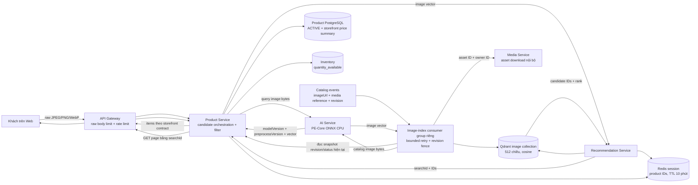
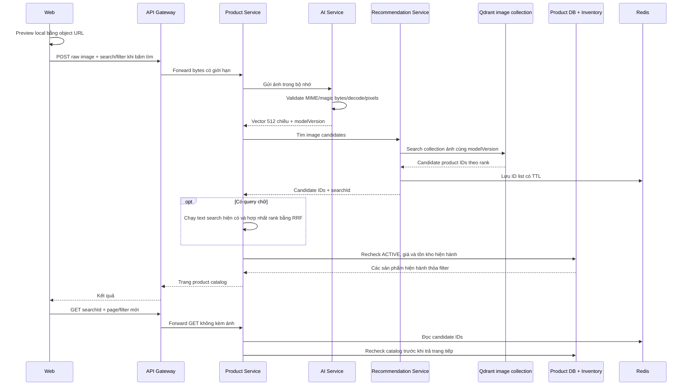
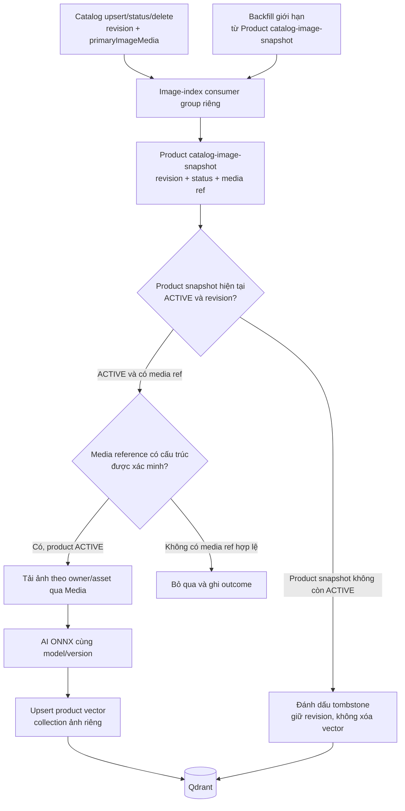

# Lộ trình và sơ đồ cấu trúc tìm sản phẩm bằng hình ảnh

**Trạng thái hiện tại (2026-11-24):** Phase 1 đã hoàn tất; Phase 2 indexer và
Phase 3 backend public image search đã có code. Phase 4 Web UI đã nối API, có
preview, upload chủ động, trạng thái lỗi/fallback, kết quả rỗng và phân trang
session; đã có 9 component/hook tests. Worker/index vẫn mặc định tắt; chưa
export/cấp artifact hoặc chạy backfill. Phase 6 đã có evaluator JSONL và unit
tests; chưa có nhãn người đánh giá để chạy retrieval evaluation. Các thay đổi Git
đã tồn tại được giữ nguyên; không suy ra chúng thuộc feature chỉ từ trạng thái
dirty.

Thiết kế chi tiết, phương án model, chi phí, bảo mật và API dự kiến nằm trong
[image-search-plan.md](./image-search-plan.md).
Schema JSONL, cách gán nhãn và chạy retrieval evaluator nằm trong
[image-search-evaluation.md](./image-search-evaluation.md).

## Giai đoạn thực hiện

| Giai đoạn                        | Phạm vi                                                                                                                                                                                                                                       | Đầu ra                                                                                                                                                     | Điều kiện hoàn tất                                                                                                                                                                                                                                | Trạng thái                                                         |
| -------------------------------- | --------------------------------------------------------------------------------------------------------------------------------------------------------------------------------------------------------------------------------------------- | ---------------------------------------------------------------------------------------------------------------------------------------------------------- | ------------------------------------------------------------------------------------------------------------------------------------------------------------------------------------------------------------------------------------------------- | ------------------------------------------------------------------ |
| 1. Rà repo và chốt thiết kế      | Đọc chỉ dẫn, git status, web search, Product/Gateway, AI, Recommendation/Qdrant/Redis, Media, catalog events; xác định model/vector space, luồng dữ liệu, bảo mật, chi phí, API và file dự kiến.                                              | Hai tài liệu này: kiến trúc, API contract sơ bộ, lựa chọn PE-Core self-host, code tree, điều kiện phụ thuộc và kế hoạch kiểm chứng.                        | Tách rõ image/text vector; xác định nguồn giá/tồn kho; phát hiện contract Media reference, consumer isolation, revision fence, bootstrap mặc định tắt và AI artifact chưa được cấp.                                                               | **Hoàn tất sau review**                                            |
| 2. Index ảnh catalog             | Đã bổ sung media reference vào catalog event/Product snapshot; consumer group ảnh riêng đọc Product snapshot mới nhất, tải asset qua Media, gọi AI ONNX, ghi collection vật lý versioned; có tombstone và backfill keyset tối đa 25 sản phẩm. | Pipeline idempotent theo asset/model/revision; collection cosine/512; cursor, retry theo Kafka processor hiện có, metrics và test. Không cần migration DB. | Worker tách khỏi text projection; so revision dạng bigint; chạy lại cursor an toàn; byte cap ở Media/AI; image workload không làm hỏng text search. Đồng bộ eventual consistency; Phase 3 phải đối chiếu revision candidate với Product hiện tại. | **Code đã triển khai; kiểm chứng và rollout còn**                  |
| 3. API tìm ảnh và lọc catalog    | Product nhận raw upload, gọi AI embedding route, truy vấn collection ảnh Qdrant, lọc candidate hiện hành, hợp nhất rank chữ bằng RRF, áp ACTIVE/giá/tồn kho trong Product DB và phân trang qua session. AI có cache bounded/single-flight.    | Product POST ảnh + GET session/page; Recommendation candidate/session routes; cache RAM 256 vector/10 phút.                                                | Sai file/model/dimension/preprocess bị từ chối; cache không giữ ảnh/log hash; `inStock` dùng available stock và fail-closed khi thiếu inventory row; giá/tồn kho không lấy từ Qdrant; fallback minh bạch.                                         | **Backend đã triển khai**                                          |
| 4. Gateway và giao diện Web      | Gateway raw parser/proxy/rate limit 10/phút/IP và concurrency 2/process đã có. Web giữ tìm chữ/filter URL hiện tại, thêm preview local, submit chủ động, loading/results/empty/error/retry/remove và pagination theo session.                 | Gateway routes; Web shadcn controls, feature hook/component, API client/types.                                                                             | Preview không upload; đổi filter/query/page không gửi ảnh lại; remove thu hồi URL; text search không bị ảnh hưởng.                                                                                                                                | **Đã triển khai; cần xác minh trên runtime**                       |
| 5. Logging, giới hạn và vận hành | Có request size limits, rate/concurrency controls, redacted image-search access logs, AI cache counters và Recommendation outcome/duration metrics. Artifact provisioning, lag/backlog telemetry, benchmark và runbook rollout còn lại.       | Metrics không chứa ảnh/vector/hash/URL/user/product IDs; hướng dẫn cấp model, backfill và dọn collection.                                                  | Chưa đổi Kubernetes resources; cần benchmark CPU/RAM và p50/p95, xác minh log/tracing trên môi trường chạy thật trước rollout.                                                                                                                    | **Backend safeguards đã có; rollout còn**                          |
| 6. Test và đánh giá              | Phase 3 có unit tests backend cho AI cache, Product RRF/fallback và Recommendation candidate/session; Phase 4 có 5 component tests và 4 hook tests. Phase 6 thêm JSONL evaluator, metric tests và lệnh chạy an toàn.                          | `npm run image-search-evaluate`; báo cáo Recall@10/NDCG@10/filter compliance/p50-p95, fallback và lỗi theo scenario.                                       | Chỉ kết luận retrieval bằng query ảnh có nhãn người đánh giá; cần cấp model artifact và backfill collection trước khi chạy đánh giá thật.                                                                                                         | **Evaluator và unit tests đã có; đo retrieval còn chờ nhãn/index** |

## Sơ đồ kiến trúc mục tiêu

Luồng bên trái mô tả backend đã triển khai ở Phase 3 và Web UI đã triển khai ở
Phase 4. Luồng index catalog đã có code Phase 2 nhưng vẫn chờ model artifact và
backfill để tạo dữ liệu tìm kiếm thật.



## Luồng tìm kiếm và index





Revision được đọc từ Product trước khi thao tác Qdrant nhưng hai thao tác không nằm
trong một transaction. Do đó consumer không bảo đảm loại bỏ mọi race giữa nhiều
instance; khi tìm kiếm, Product phải xác minh lại revision candidate hiện hành.

## API dự kiến

| API                                                                                                 | Request                                                                                                                                                                                                                                                                                                    | Response/contract                                                                                                                                                                                             |
| --------------------------------------------------------------------------------------------------- | ---------------------------------------------------------------------------------------------------------------------------------------------------------------------------------------------------------------------------------------------------------------------------------------------------------- | ------------------------------------------------------------------------------------------------------------------------------------------------------------------------------------------------------------- |
| `POST /api/v1/products/image-searches`                                                              | Raw JPEG/PNG/WebP tối đa 5 MiB; query params allowlist: `search`, `categoryId`, `sellerShopId`, `minPrice`, `maxPrice`, `minRating`, `inStock`, `sort`, `page`, `pageSize`. `page >= 1`, `pageSize` 1–100 (mặc định 20) theo DTO storefront. Không nhận `status`; một ảnh/lần tìm; đảo khoảng giá trả 400. | `{ searchId, mode, items, total, page, pageSize, totalPages }`; `searchId` bắt buộc với `IMAGE`/`IMAGE_AND_TEXT`, null với `TEXT_FALLBACK`. `total` chỉ tính pool candidates giới hạn.                        |
| `GET /api/v1/products/image-searches/:searchId`                                                     | Cùng allowlist query/filter/page/sort; `page >= 1`, `pageSize` 1–100 (mặc định 20); không gửi ảnh và không cho đặt `status`.                                                                                                                                                                               | Recheck Product DB rồi trả cùng page contract. Session ID khó đoán, TTL 600 giây; hết hạn image-only trả 410, có text query chuyển `TEXT_FALLBACK` và Web dùng storefront route hiện hữu cho phân trang tiếp. |
| `POST /api/v1/search-ranking/image-embedding`                                                       | Đã có ở Phase 2; raw image bytes + service token.                                                                                                                                                                                                                                                          | `{ modelVersion, dimensions: 512, preprocessVersion, vector }`; response mang đủ contract để từ chối vector khác preprocessing.                                                                               |
| `POST /api/v1/recommendation/catalog/image-search/candidates`                                       | Nội bộ; vector 512 chiều + candidate limit.                                                                                                                                                                                                                                                                | Candidate IDs/rank từ Qdrant; Product xác minh lại.                                                                                                                                                           |
| `POST /api/v1/recommendation/catalog/image-search/sessions` / `GET .../sessions/:searchId`          | Tối đa 500 product IDs.                                                                                                                                                                                                                                                                                    | Session Redis chỉ lưu ID list trong 600 giây.                                                                                                                                                                 |
| `POST /api/v1/recommendation/catalog/image-index/backfill`                                          | Đã có ở Phase 2; `limit` 1–25, `afterProductId` tùy chọn.                                                                                                                                                                                                                                                  | `{ processed, skipped, nextCursor }`; lỗi giữa batch trả lỗi để gọi lại cùng cursor, thao tác đã hoàn tất là idempotent.                                                                                      |
| Catalog event + `GET /api/v1/internal/products/catalog-image-snapshot?afterProductId=...&limit=...` | Đã có ở Phase 2; Product → Recommendation, `primaryImageMedia` gồm owner/asset/purpose; snapshot dùng keyset cursor.                                                                                                                                                                                       | Recommendation tải Media bằng ID nội bộ; không fetch URL tùy ý. Không thêm migration DB.                                                                                                                      |

Các route public Product và internal candidate/session trong bảng đã được triển
khai ở Phase 3. Stack local đã chạy với model PE-Core và chỉ mục Qdrant v2.
Môi trường mới cần cấp model và backfill catalog trước khi bật tìm ảnh.

## Cấu trúc code hiện tại và kế hoạch

Các nhánh bên dưới thể hiện code backend Phase 2–3 và Web UI Phase 4 đã có trong repo.

```text
docs/search/
├── image-search-evaluation.md
├── image-search-plan.md
└── image-search-roadmap-and-structure.md

services/product-service/src/modules/storefront/
├── presentation/
│   ├── controllers/storefront-products.controller.ts
│   └── dto/image-search/storefront-image-search-query.dto.ts
├── application/
│   ├── clients/
│   │   ├── image-search/ (AI embedding và Recommendation)
│   │   └── text-search/ (AI reranker và ứng viên ngữ nghĩa)
│   ├── ports/image-search/
│   │   ├── image-search-embedding.port.ts
│   │   └── image-search-recommendation.port.ts
│   ├── services/storefront/
│   │   ├── image-search/ (tìm ảnh và test)
│   │   ├── products/ (đọc catalog công khai và test)
│   │   └── search/ (xếp hạng tìm chữ)
│   └── types/
│       ├── image-search/ (ứng viên và phiên tìm ảnh)
│       └── text-search/ (gợi ý và xếp hạng tìm chữ)
└── infrastructure/
    └── repositories/typeorm-storefront-search.repository.ts

services/product-service/src/modules/internal/
├── application/services/product-image-snapshot/
├── infrastructure/repositories/product-image-snapshot/ (repository và test)
└── presentation/controllers/internal-product.controller.ts

services/api-gateway/src/modules/product/
├── product-proxy.controller.ts
└── image-search/ (middleware giới hạn upload và test)

services/media-service/src/modules/media/
├── application/services/assets/ (đọc và quản lý asset, kèm test)
└── presentation/dto/
    ├── cleanup/ (dọn asset sản phẩm và đánh giá)
    └── uploads/ (tạo URL upload và nhận ảnh từ AI)

services/recommendation-service/src/modules/catalog/
├── image-index/
│   ├── application/
│   │   ├── clients/
│   │   │   ├── catalog-media/ (Product snapshot và tải ảnh qua Media)
│   │   │   └── embedding/ (AI Service)
│   │   └── services/ (index catalog và phiên tìm ảnh)
│   └── infrastructure/repositories/
│       ├── search-session/ (Redis)
│       └── vector-index/ (Qdrant)
└── presentation/
    ├── controllers/catalog.controller.ts
    └── dto/image-search/

services/recommendation-service/src/kafka/
└── consumers/catalog-image/ (consumer group riêng)

services/recommendation-service/src/scripts/
├── image-search-evaluation/
│   ├── cli.ts
│   ├── dataset/dataset-loader.ts (+ unit tests)
│   ├── evaluation/image-search-evaluator.ts (+ unit tests)
│   └── metrics/metrics.ts (+ unit tests)
├── ranking-evaluation/
│   ├── criteria/ (đánh giá tiêu chí 3–8)
│   └── evaluate-session-context-formulas.ts
├── ranking-data/ (sinh dữ liệu synthetic và audit dữ liệu huấn luyện)
└── profile-affinity/ (chẩn đoán synthetic và kiểm chứng PostgreSQL)

services/ai-service/app/modules/search_ranking/image_embedding/
├── application/ (preprocessing, service, RAM vector cache)
├── infrastructure/onnx_provider.py
└── presentation/ (router, schemas)

services/ai-service/scripts/export_image_search_model.py

infra/nginx/conf.d/default.conf (body, rate/concurrency, access-log policy)

web/public/images/search/
└── image-search-visual.webp (minh họa tìm sản phẩm đồng bộ palette storefront)

web/src/features/product-search/
├── components/image-search/
│   ├── ImageSearchPanel.tsx
│   └── ImageSearchPanel.spec.tsx
├── hooks/image-search/ (phiên tìm ảnh, chọn ảnh từ header và test)
└── types/image-search.types.ts

web/src/services/product/
├── api/product.api.ts (POST raw image và GET session)
└── types/product-image-search.types.ts
```

Phase 4 giữ các filter trong URL hiện tại, gửi ảnh đúng một lần ở thao tác POST
và dùng GET session khi filter/query/page thay đổi. Preview chỉ dùng object URL
trong browser; xóa ảnh hoặc rời trang sẽ thu hồi URL và bỏ session khỏi cache
cục bộ. UI tiếp tục dùng `@/*`, shadcn, comment tiếng Việt, Prettier và
validation theo package.

## Rủi ro và việc còn lại

- Stack local đã chạy với ONNX artifact. Khi rollout sang môi trường khác, cần
  xác minh checksum/version của artifact và đo RSS, throughput lập chỉ mục và
  độ trễ inference với giới hạn tài nguyên của môi trường đó.
- Product snapshot read và Qdrant mutation không nguyên tử. Worker dùng queue
  tuần tự trong một process và revision guard trên point; nhiều instance vẫn có
  thể đua. Trước khi xếp hạng, Product đối chiếu trạng thái, bộ lọc và fingerprint
  gallery với catalog hiện tại. Thay đổi tồn kho vẫn có thể dùng phiên cũ nếu
  fingerprint ảnh còn khớp.
- Qdrant adapter ghi collection vật lý có tên gồm alias, version vận hành và
  fingerprint SHA-256 của model/preprocess/dimension. Alias chỉ được tạo nếu chưa
  tồn tại; khi rollout operator cần promote alias sau coverage/catch-up. Tombstone
  giữ vector cùng revision và `indexable=false`; candidate query phải loại điểm đó
  và cần có chính sách dọn tombstone/collection cũ.
- Consumer mới dùng `fromBeginning=true` nên có thể replay mọi event còn retained
  khi group lần đầu chạy. Metrics hiện chưa có offset lag theo partition/backlog
  age và cutover barrier tự động; phải quan sát catch-up trước promote alias.
- Product API hiện lọc `ACTIVE`, giá summary storefront và
  `inventories.quantity_available`; thiếu inventory row bị loại khi `inStock`.
  Giá/tồn kho không lấy từ Qdrant.
- Phase 3 đã thêm raw upload và giới hạn body, rate và số kết nối ở Nginx.
  Access log của route tìm ảnh dùng định dạng giới hạn metadata. Gateway ghi nhận
  cả 429/413 trước khi parse body, còn Product ghi route theo template.
- PE-Core self-host có phí API embedding $0; vector float32 512 chiều tốn 2.048
  byte/ảnh thô, khoảng 205 MB/100.000 ảnh hoặc 2.05 GB/một triệu ảnh trước
  Qdrant overhead. Blue/green rollout có thể tạm giữ gần gấp đôi phần vector.
- Evaluator JSONL đo được Recall@10, NDCG@10, tỷ lệ thỏa bộ lọc và p50/p95.
  Các lượt đo local đã ghi trong [tài liệu đánh giá](image-search-evaluation.md).
  Bộ truy vấn đã đo chủ yếu dùng ảnh biến đổi từ mẫu có sẵn. Cần bổ sung bộ ảnh
  độc lập có nhãn để đánh giá chất lượng trên nhiều ngành hàng.
- Qdrant v2 lập chỉ mục tối đa năm ảnh gallery mỗi sản phẩm. Mô tả chữ thu hẹp
  tập ứng viên ảnh theo dữ liệu catalog. `total` đếm kết quả trong tập ứng viên
  đã lọc.

## Kết quả theo giai đoạn

- **Phase 1:** Hoàn tất review kiến trúc; xác định không trộn vector ảnh và chữ,
  nguồn giá/tồn kho có thẩm quyền, media reference cần thiết, ranh giới dịch vụ,
  lựa chọn PE-Core self-host, API dự kiến, bảo mật và chi phí.
- **Phase 2:** Code pipeline nội bộ đã triển khai: event/reference, Product
  snapshot, Media byte cap, AI ONNX endpoint/exporter và Recommendation indexer,
  Qdrant adapter, backfill, metrics/tests. Worker mặc định tắt. Việc sửa lần này
  bổ sung kiểm tra `preprocessVersion` cả ở AI response và Recommendation client,
  đồng thời fingerprint vector space trong tên collection.
- **Phase 3:** Đã triển khai Product public POST/GET, AI embedding client/cache,
  API ứng viên và phiên tìm ảnh của Recommendation, bộ lọc catalog PostgreSQL,
  đối chiếu fingerprint gallery, fallback tìm chữ và giới hạn upload.
- **Phase 4:** Web có bộ chọn/preview ảnh, POST raw upload theo thao tác khách,
  GET session cho query/filter/page, kết quả rỗng/lỗi/fallback và xóa ảnh; text
  search hiện tại vẫn dùng nguyên URL/API của storefront.
- **Stack local:** Đã backfill Qdrant v2 và kiểm tra ca sửa ảnh, đổi tồn kho
  và gỡ mẫu QA qua giao diện seller. Sau khi gỡ mẫu, chỉ mục khớp 263/263 sản phẩm
  đủ điều kiện trong catalog dùng cho lượt kiểm thử.
